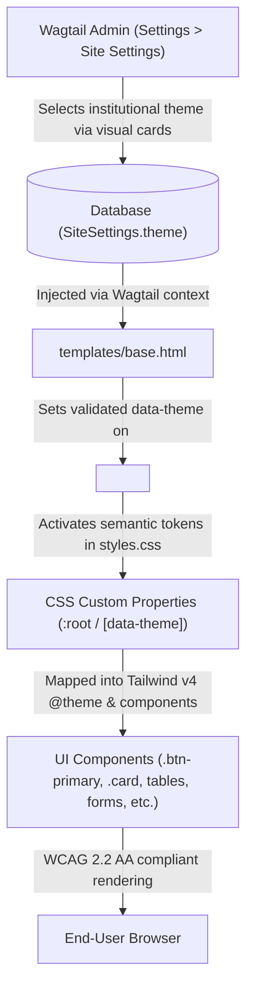

# Institutional Theming & Styling Guide

This guide explains the institutional theming architecture in the Nakashara Institutional CMS, detailing the five calm, accessible design themes, admin-managed theme selection, CSS design tokens, and instructions for developers to extend or customize themes.

---

## 1. Architecture Overview

Nakashara CMS uses a server-rendered, token-driven theming architecture combining **Wagtail Site Settings**, **Tailwind CSS v4 (CSS-first configuration)**, and **DaisyUI v5 component primitives** (with built-in themes disabled).

The core design principle is **authoritative institutional elegance with zero hardcoded brand colors in templates**. All UI components consume semantic design tokens (`primary`, `secondary`, `accent`, `page-bg`, `base-100`, `base-200`, `base-300`, `base-content`, `heading`, `link`, etc.). When an administrator selects a theme in Wagtail Admin, the public website immediately reflects the selected theme server-side without rebuilding static assets or causing client-side theme flash.



### Key Architectural Pillars

1. **DaisyUI Built-in Theme System Removed**:
   - DaisyUI v5 plugin is configured with `themes: false;`.
   - All 35+ built-in DaisyUI palettes (`corporate`, `emerald`, `nord`, `dracula`, `luxury`, etc.) are completely excluded.
   - DaisyUI component utilities (`.btn`, `.card`, `.badge`, `.table`, `.tabs`, `.alert`) are retained because they provide clean, accessible structural primitives while delegating all color resolution to project-owned semantic design tokens.

2. **Centralized Python Theme Definitions (`apps/site_settings/themes.py`)**:
   - Single source of truth for theme identifiers, human-readable names, descriptions, and color swatches.
   - Provides `VALID_THEMES`, `DEFAULT_THEME = "academic-blue"`, and validation helper `is_valid_theme(theme_id)`.

3. **Visual Wagtail Admin Selector (`apps/site_settings/widgets.py`)**:
   - `ThemeRadioSelect` renders interactive theme selection cards in the admin panel.
   - Displays human-readable titles, descriptions, horizontal color swatches, active theme badge, and a compact live component preview (heading, body, primary button, secondary button, badge, link, input field) styled directly with each theme's CSS tokens.

4. **Safe Server-Side Rendering (`templates/base.html`)**:
   - Renders `<html lang="{{ page.locale.language_code|default:'en' }}" data-theme="{{ site_settings.active_theme|default:'academic-blue' }}" ...>`.
   - Never injects unvalidated or arbitrary CSS into the DOM.
   - Invalid or missing theme values safely fall back to `academic-blue`.

5. **Multi-Site Theme Isolation**:
   - Wagtail `SiteSettings` operates per `Site`. In a multi-tenant institutional setup, each domain or campus site selects its own active theme independently.

---

## 2. The Five Institutional Themes

The CMS provides five curated institutional color palettes designed specifically for academic, research, and governance institutions. All themes adhere strictly to **WCAG 2.2 AA contrast standards** (minimum 4.5:1 for body text and 3:1 for large headings and interface controls).

| Theme Identifier | Name | Visual Direction | Primary Tone | Page Background | Surface | Contrast Ratio |
|---|---|---|---|---|---|---|
| `academic-blue` *(Default)* | Academic Blue | Authoritative, scholarly, and timeless institutional navy | `#17365D` (Navy) | `#F7F8FA` | `#FFFFFF` | 14.6:1 (text:surface)<br>12.2:1 (primary fg:bg) |
| `sage-ivory` | Sage & Ivory | Organic, grounded, calm botanical tones for environmental and life sciences | `#344B40` (Deep Sage) | `#F5F6F0` | `#FFFFFF` | 13.8:1 (text:surface)<br>10.6:1 (primary fg:bg) |
| `slate-steel` | Slate & Steel | Disciplined, modern architectural slate for engineering, technology, and governance | `#334155` (Slate) | `#F3F5F7` | `#FFFFFF` | 14.6:1 (text:surface)<br>11.8:1 (primary fg:bg) |
| `burgundy-cream` | Burgundy & Cream | Rich, distinguished, editorial warmth for arts, law, humanities, and heritage collections | `#633B43` (Burgundy) | `#FAF7F2` | `#FFFFFF` | 15.3:1 (text:surface)<br>10.9:1 (primary fg:bg) |
| `teal-stone` | Teal & Stone | Refreshing, composed, intellectual teal for public policy, economics, and interdisciplinary institutes | `#244B4B` (Teal) | `#F5F7F6` | `#FFFFFF` | 14.2:1 (text:surface)<br>11.3:1 (primary fg:bg) |

### Color Token Specifications

Each theme implements complete semantic token sets:

- **Core Colors**: `primary`, `primary-hover`, `primary-foreground`, `secondary`, `secondary-hover`, `secondary-foreground`, `accent`, `accent-hover`, `accent-foreground`.
- **Surfaces**: `page-bg` (main canvas), `surface` / `base-100` (cards, dialogs), `surface-secondary` / `base-200` (subtle panels, table headers), `base-300` (borders, dividers), `surface-elevated` (popovers, dropdowns), `header-bg`, `footer-bg`.
- **Typography**: `text-main` / `base-content`, `text-secondary`, `text-muted`, `heading`, `link`, `link-hover`.
- **Borders & Interactive States**: `border-default`, `border-strong`, `divider`, `focus-ring`, `hover-bg`, `selected-bg`.
- **Feedback Alerts**: `success` (`#1B4D3E`), `warning` (`#92400E`), `error` (`#991B1B`), `info` (`#1E3A8A`).

---

## 3. How Administrators Change the Active Theme

Site administrators change the website theme in real time from the Wagtail Admin:

1. Log into the Wagtail Admin (`/admin/`).
2. In the navigation sidebar, go to **Settings** > **Site Settings**.
3. Under the **Appearance & Theme** tab, locate the **Active Website Theme** section.
4. Review the visual theme cards. Each card displays:
   - Radio button for selection
   - Human-readable theme title and description
   - Color swatch bar previewing page background, surface, primary, secondary, and accent colors
   - An "Active Theme" indicator badge on the currently saved theme
   - A compact component preview demonstrating real typography, primary CTA button, secondary button, badge, link, and input field styled with that theme's palette
5. Click the radio card of the desired theme.
6. Click **Save** at the bottom of the page.
7. Open the public website in your browser. The new theme is immediately applied across all public pages, headers, footers, StreamField blocks, forms, and listings.

---

## 4. How Theme Identifiers and CSS Tokens Work

### Centralized Definitions (`apps/site_settings/themes.py`)

Theme configuration is defined centrally in Python:

```python
THEMES: dict[str, ThemeMeta] = {
    "academic-blue": ThemeMeta(
        id="academic-blue",
        name="Academic Blue",
        description="Authoritative, scholarly, and timeless institutional navy with antique gold accents.",
        page_bg="#F7F8FA",
        surface="#FFFFFF",
        primary="#17365D",
        secondary="#52749A",
        accent="#D6A75D",
        text="#202C3A",
    ),
    # ... other themes
}
```

### CSS Token Declarations (`theme/static_src/src/styles.css`)

Themes are defined as CSS custom properties keyed by `[data-theme="<id>"]`:

```css
:root,
[data-theme="academic-blue"] {
  --color-primary: #17365d;
  --color-primary-hover: #102642;
  --color-primary-content: #ffffff;
  --color-secondary: #52749a;
  --color-secondary-hover: #405d7d;
  --color-secondary-content: #ffffff;
  --color-accent: #d6a75d;
  --color-accent-hover: #c49448;
  --color-accent-content: #1e2631;
  --color-page-bg: #f7f8fa;
  --color-base-100: #ffffff;
  --color-base-200: #eef2f6;
  --color-base-300: #d8e0e9;
  --color-base-content: #202c3a;
  --color-heading: #17365d;
  --color-link: #17365d;
  --color-link-hover: #0f233d;
  /* ... border, feedback, and surface tokens */
}

[data-theme="sage-ivory"] {
  --color-primary: #344b40;
  /* ... */
}
```

### Tailwind CSS v4 `@theme` Binding

Tokens are mapped into Tailwind v4's CSS-first `@theme` block:

```css
@theme {
  --color-primary: var(--color-primary);
  --color-primary-hover: var(--color-primary-hover);
  --color-primary-content: var(--color-primary-content);
  --color-secondary: var(--color-secondary);
  --color-accent: var(--color-accent);
  --color-page-bg: var(--color-page-bg);
  --color-base-100: var(--color-base-100);
  --color-base-200: var(--color-base-200);
  --color-base-300: var(--color-base-300);
  --color-base-content: var(--color-base-content);
  --color-heading: var(--color-heading);
  --color-link: var(--color-link);
  --color-link-hover: var(--color-link-hover);
  --color-border-default: var(--color-border-default);
  --color-border-strong: var(--color-border-strong);
}
```

Components in templates consume these semantic utilities:
- `bg-page-bg text-base-content` on `<body>`
- `bg-base-100 border border-base-300` on content cards
- `btn btn-primary` / `btn btn-secondary` on CTAs
- `badge badge-accent` on featured highlights
- `text-heading font-serif` on titles

---

## 5. Authoritative Institutional Badge System

To prevent conflicting utility classes (`text-secondary-content/10`, `text-secondary`, `bg-secondary`, `text-base-content`) and ensure visual consistency across all public templates, the CMS provides a centralized, authoritative badge system defined in `theme/static_src/src/styles.css`.

### Badge Anatomy & Defaults
- **Shape**: Always pill-shaped with `border-radius: 9999px !important;` (overriding any DaisyUI square/rounded-box defaults).
- **Background**: Subtle tinted background derived from the active theme's palette.
- **Border**: Thin 1px border matching the variant's border token for crisp definition on both pure white surfaces and tinted page backgrounds.
- **Typography**: Semibold 600 weight, uppercase/small caps tracking (`0.025em`), with high-contrast text guaranteed to exceed WCAG 2.2 AA (minimum 4.5:1, typical > 7:1).
- **Interactive State**: Links (`a.badge`) and buttons (`button.badge`) have dedicated hover and `:focus-visible` states with theme-aware focus rings (`outline: 2px solid var(--color-focus-ring)`).

### Size Variants
- `.badge-xs`: Compact metadata tag (font size 0.6875rem, min-height 1.125rem) used on index cards and dense listings.
- `.badge-sm`: Standard listing badge (font size 0.6875rem, min-height 1.25rem) used in news grids, event listings, and department summaries.
- `.badge-md`: Default badge size (font size 0.75rem, min-height 1.5rem) used on detail pages and article hero headers.
- `.badge-lg`: Prominent status tag (font size 0.8125rem, min-height 1.75rem).

### Semantic Variants & Tokens
Each theme defines complete, accessible tokens for badge variants:
- `.badge-primary`: Tinted primary background (`--color-badge-primary-bg`), primary text (`--color-badge-primary-text`), and border (`--color-badge-primary-border`).
- `.badge-secondary`: Tinted secondary background, secondary text, and border (used for categories across news, events, and publications).
- `.badge-accent`: Tinted accent background and dark text (used for featured items and key notices).
- `.badge-neutral` / `.badge-ghost`: Subtle muted neutral background and text (used for closed statuses, archived content, and general metadata).
- `.badge-outline`: Transparent background with theme border (`--color-border-strong`) and main text (`--color-text-main`).
- `.badge-success`, `.badge-warning`, `.badge-error`, `.badge-info`: Dedicated feedback tokens.

### Standard Template Usage
```django
{# Category Badge (Pill-shaped, theme-aware, accessible) #}
<a href="{{ page.get_parent.url }}?category={{ cat.slug }}"
   class="badge badge-secondary badge-md"
   aria-label="Category: {{ cat.name }}">
  {{ cat.name }}
</a>

{# Status Badge #}
<span class="badge badge-neutral badge-sm">{{ page.get_status_display }}</span>
```

---

## 6. Homepage Architecture & Theme Integration

### Hero Carousel Architecture
The homepage multi-slide hero carousel (`templates/home/home_page.html`) is engineered with CSS grid stacking to eliminate layout shifts, overlapping text, and navigation collisions:
- **Grid-Stacked Coordinate System**: The carousel container uses CSS Grid with `[&>*]:col-start-1 [&>*]:row-start-1`. All slides occupy the exact same coordinate cell, allowing smooth cross-fading during transitions without displacing height or jumping.
- **Full Viewport Fill**: Hero images utilize `w-full h-full object-cover object-center` within a fixed height container (`min-h-[520px] md:min-h-[600px] lg:min-h-[660px]`).
- **Dual Protective Scrims**:
  1. Horizontal Scrim (`.hero-carousel-scrim`): Gradient overlay from dark utility header color (`--color-header-utility-bg`) to transparent, providing optimal legibility on wide screens while showing imagery on the right.
  2. Vertical Scrim (`.hero-carousel-scrim-vertical`): Radial gradient overlay from the bottom up, ensuring text and buttons remain legible on mobile portrait screens.
- **Safe Navigation Area**: Slide content containers include safe bottom padding (`pb-28 sm:pb-24 lg:pb-24`), guaranteeing that slide text, badges, and CTA buttons never collide with pagination dots or next/previous arrows.
- **Accessible Navigation**: Dot indicators and arrow controls use theme-aware interactive states with high contrast and minimum 44×44px tap targets.

### News, Events & Circulars Theme Integration
- **News Section**: Category badges use `.badge-secondary.badge-xs`. Empty or placeholder images use `bg-base-200 text-primary` instead of hardcoded `slate-900`.
- **Events Section**: Date cards use theme primary canvas (`bg-primary text-primary-content`) with antique gold/accent month headers (`text-accent`), ensuring high contrast across all 5 themes. Event category badges follow the unified pill badge component.
- **Collaborate & Quick Links**: Cards and banners use `bg-primary text-primary-content border-primary/20` and theme button variants instead of hardcoded slate utilities.

---

## 7. How to Add a Sixth Theme in the Future

Adding a new institutional theme requires four straightforward steps:

### Step 1: Register in `apps/site_settings/themes.py`

Add the new theme definition to `THEMES`:

```python
"emerald-sand": ThemeMeta(
    id="emerald-sand",
    name="Emerald & Sand",
    description="Refined botanical green with warm sandstone accents for natural sciences.",
    page_bg="#F6F7F5",
    surface="#FFFFFF",
    primary="#224838",
    secondary="#557565",
    accent="#C2A46C",
    text="#26332C",
    border="#DFE5E0",
    hover="#EBEFEA",
),
```

### Step 2: Define CSS Tokens in `theme/static_src/src/styles.css`

Add the CSS token block under the matching `[data-theme="emerald-sand"]` selector:

```css
[data-theme="emerald-sand"] {
  --color-primary: #224838;
  --color-primary-hover: #183327;
  --color-primary-content: #ffffff;
  --color-secondary: #557565;
  --color-secondary-hover: #435e50;
  --color-secondary-content: #ffffff;
  --color-accent: #c2a46c;
  --color-accent-hover: #ae9056;
  --color-accent-content: #1e2922;
  --color-page-bg: #f6f7f5;
  --color-base-100: #ffffff;
  --color-base-200: #edf1ee;
  --color-base-300: #dfe5e0;
  --color-base-content: #26332c;
  --color-heading: #224838;
  --color-link: #224838;
  --color-link-hover: #162e24;
  --color-border-default: #dfe5e0;
  --color-border-strong: #c4cdc6;
  --color-focus-ring: #224838;
  --color-hover-bg: #edf1ee;
  --color-selected-bg: #e2e8e4;
  --color-header-bg: #ffffff;
  --color-footer-bg: #183327;
}
```

### Step 3: Run Database Migrations

Generate and apply the Django migration to update the model field choices:

```bash
uv run python manage.py makemigrations site_settings
uv run python manage.py migrate site_settings
```

### Step 4: Rebuild Tailwind CSS

Compile the updated stylesheet:

```bash
uv run python manage.py tailwind build
```

The new theme immediately appears in Wagtail Admin with its swatches and live component preview.

---

## 8. Removed DaisyUI Dependencies & Deprecated Features

The following items were removed or deprecated as part of the design system overhaul:

1. **`themes: all;` Removed**:
   DaisyUI's `@plugin "daisyui" { themes: all; }` was replaced with `themes: false;`. No built-in DaisyUI theme CSS or opinionated palette rules are generated.
2. **Old Theme Identifiers Deprecated**:
   Old themes (`corporate`, `emerald`, `nord`, `winter`, `business`, `night`, `autumn`, `luxury`, `light`) were superseded by the 5 institutional themes. Migration `0008_alter_sitesettings_theme.py` safely migrated existing database rows to `academic-blue`.
3. **Inline CSS Injection Removed**:
   Removed inline `style="--color-primary: ..."` attributes from `templates/base.html`. All colors are strictly managed through validated `data-theme` attributes and pre-compiled CSS design tokens.
4. **Hardcoded Accent Classes Cleaned**:
   Hardcoded classes such as `text-amber-500`, `bg-amber-500`, and `border-amber-500` were replaced across public templates (`footer.html`, `home_page.html`, `social_links.html`, `contact_details.html`, `person_page.html`) with semantic tokens (`text-accent`, `bg-accent`, `border-accent`).
5. **Conflicting Badge Classes Eliminated**:
   Eliminated compound conflicting classes such as `text-secondary-content/10 text-secondary bg-secondary text-secondary-content hover:text-white` across news, events, people, departments, and search templates, replacing them with authoritative, single-definition `.badge` classes.

---

## 9. Testing & Verification

Comprehensive automated test coverage ensures the integrity of the theme system:

```bash
# Run institutional theme tests
uv run pytest tests/test_institutional_themes.py

# Run all project tests
uv run pytest

# Run Django system checks
uv run python manage.py check
```

Key test scenarios verified:
- Default theme fallback when no setting exists (`academic-blue`).
- All 5 valid theme identifiers activate correctly.
- Invalid or unrecognized theme strings safely fall back to `academic-blue`.
- Multi-site theme isolation ensures different sites maintain independent active themes.
- Public templates receive and render the active theme in `<html data-theme="...">`.
- Permission enforcement prevents non-administrators from altering site themes.
- Built CSS output contains zero built-in DaisyUI themes.
